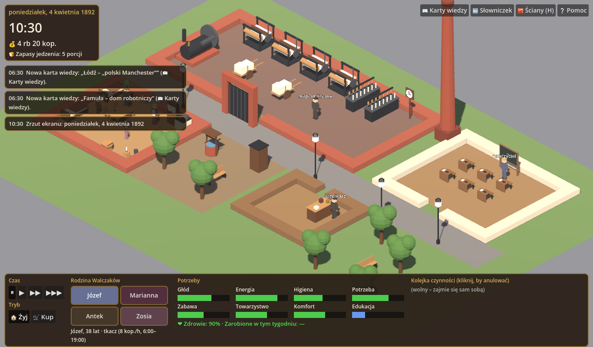
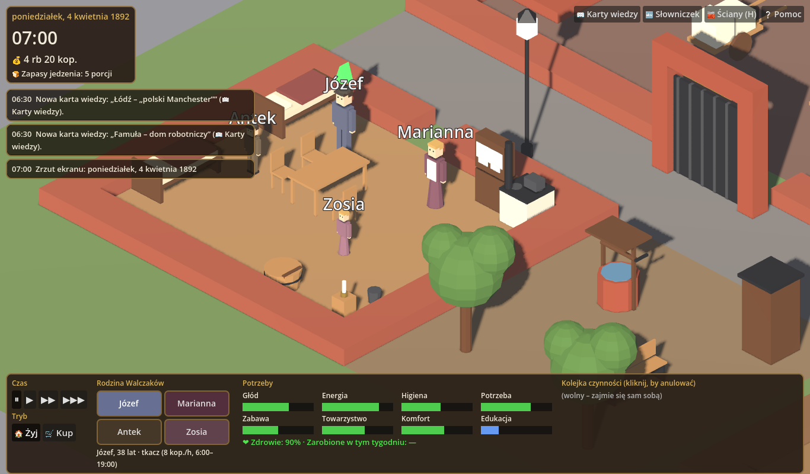
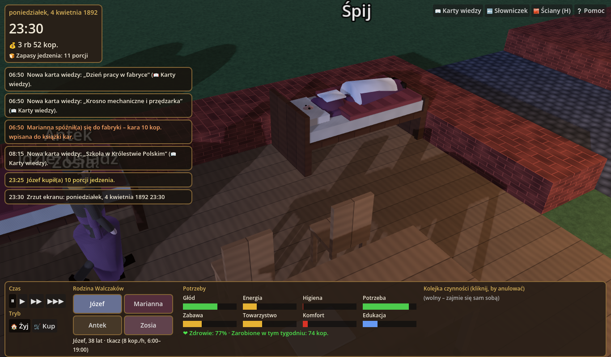
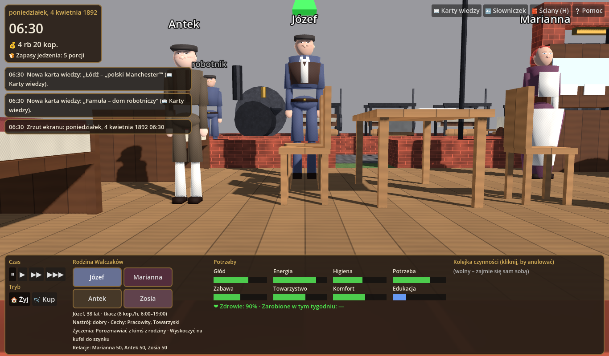
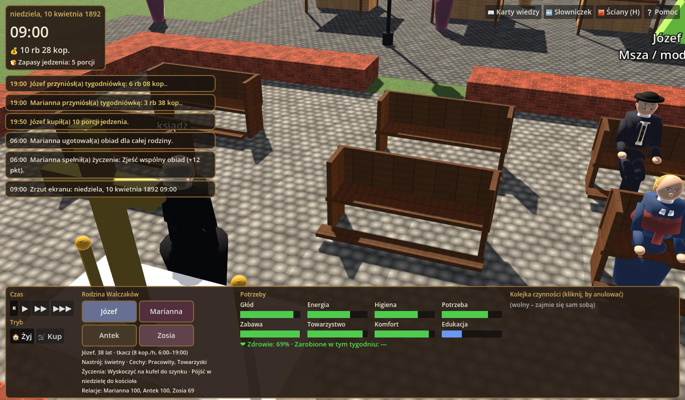

# Fabryka 1892 – Rodzina Walczaków 🏭

Gra symulacyjna w duchu **The Sims** (grafika 3D w stylu zbliżonym do **The Sims 3**) o życiu
rodziny robotniczej w **Łodzi w 1892 roku**. Gracz opiekuje się czteroosobową rodziną Walczaków
(Józef – tkacz, Marianna – prządka, dwunastoletni Antek i dziewięcioletnia Zosia), która właśnie
wynajęła izbę w famule obok fabryki bawełny. Przez 5 tygodni trzeba dbać o potrzeby Simów,
zarabiać na czynsz i jedzenie oraz podejmować decyzje, które odsłaniają **karty wiedzy**
o XIX-wiecznym przemyśle: praca dzieci i prawo z 1882 r., angielskie *Factory Acts*, kary
fabryczne, rusyfikacja szkoły i tajne nauczanie, maszyna parowa, choroby zawodowe, szynk
i bractwa trzeźwości, targ, „miasto czterech kultur”, **bunt łódzki 1892**.







*(zrzuty z programowego renderowania bez karty graficznej – `tests/screenshot.gd`)*

## Jak zagrać

| Sposób | Co zrobić |
|---|---|
| **W przeglądarce** | po wdrożeniu GitHub Pages gra jest pod adresem `https://adscisel-alt.github.io/workt/gra/` (workflow `deploy.yml` eksportuje ją obok aplikacji protokołów) |
| **Windows** | pobierz `Fabryka1892-windows.zip` z zakładki **Actions → Build game (Fabryka 1892) → Artifacts** (lub z **Releases** po oznaczeniu tagu `gra-v1.0`), rozpakuj i uruchom `Fabryka1892.exe` (jeden plik, ~110 MB, bez instalacji; SmartScreen może wymagać „Uruchom mimo to”, bo plik nie jest podpisany) |
| **Z edytora** | Godot 4.6 → Import → `gra-fabryka/godot/project.godot` → F5 |

Projekt składa się z trzech warstw narzędziowych, o które prosiłeś:

| Narzędzie | Rola w projekcie | Katalog |
|---|---|---|
| **Blender** | skrypt Pythona generuje tekstury proceduralne, 32 modele otoczenia oraz 16 postaci **z teksturowanymi twarzami, strojami z epoki, szkieletem i 7 animacjami** (idle, chód, praca, siedzenie, sen, rozmowa, jedzenie) → pliki `.glb` | `blender/` |
| **Godot 4.6** | silnik gry: świat 3D z kamerą swobodną, Simowie, potrzeby, praca, szkoła, kościół, szynk, targ, ekonomia, UI, dźwięk, zdarzenia edukacyjne, eksport Web i Windows | `godot/` |
| **Antigravity** | agentowe IDE do dalszego rozwijania kodu – gotowe reguły i workflowy dla agenta | `.agent/`, `AGENTS.md` |

---

## Uruchomienie z edytora

1. Pobierz **Godot 4.6** (wersja standardowa, bez .NET) z https://godotengine.org/download
   lub https://github.com/godotengine/godot/releases/tag/4.6-stable (plik `Godot_v4.6-stable_*`).
2. Uruchom Godot → **Import** → wskaż plik `gra-fabryka/godot/project.godot` → **Import & Edit**.
3. Przy pierwszym otwarciu edytor zaimportuje modele GLB, tekstury i dźwięki (kilkanaście sekund).
4. Naciśnij **F5** (Run Project).

Bez edytora (wiersz poleceń):

```bash
godot --path gra-fabryka/godot
```

Modele `.glb`, tekstury i dźwięki są już w repozytorium, więc **Blender nie jest wymagany
do grania** – tylko do zmiany wyglądu obiektów.

### Sterowanie

| Akcja | Klawisz / mysz |
|---|---|
| Wybór Sima | kliknięcie na postać lub portret w dolnym panelu |
| Zlecenie czynności | kliknięcie na przedmiot → menu czynności (jak w The Sims) |
| Rozmowa | mając wybranego Sima, kliknij innego Sima |
| Pauza / prędkość | **Spacja**, **1 / 2 / 3** |
| Obrót i pochylenie kamery | **prawy przycisk myszy** (przeciąganie) lub **Q / E** |
| Zoom | kółko myszy, **+ / −** |
| Przesuwanie | **WSAD**, strzałki, środkowy przycisk myszy |
| Ściany góra/dół | **H** |
| Tryb „Kup” | przycisk 🛒 Kup; **R** obraca mebel, **Esc** anuluje, kliknięcie mebla w izbie = sprzedaż |

### Zasady rozgrywki

- **Czas**: start w poniedziałek 4 kwietnia 1892, 6:30. Gra trwa 35 dni. Fabryka: 6:00–19:00
  (dzieci do 15:00) z przerwą 12:00–13:00, bez niedziel. Spóźnienie = kara 10 kop.
- **Potrzeby** (jak w The Sims): głód, energia, higiena, potrzeba fizjologiczna, zabawa,
  towarzystwo, komfort + **edukacja** (u dzieci) i **zdrowie** (spada przy głodzie, brudzie,
  braku snu, pracy w pyle bawełnianym i alkoholu; chory Sim nie pracuje).
- **Ekonomia**: ruble i kopiejki. Tkacz 8 kop./h, prządka 5 kop./h, dziecko 2 kop./h; wypłata
  w sobotę o 19:00. W poniedziałek rano czynsz 1 rb 50 kop. + 20 kop. składki szkolnej za
  każde dziecko w szkole. Gotowanie zużywa porcje zapasów – rano taniej na targu, po południu
  w sklepie.
- **Lokacje**: fabryka (krosna, przędzarki, maszyna parowa), szkoła elementarna, **kościół**
  (niedzielna msza, dzwony), famuła z izbą Walczaków, podwórze (studnia, wychodek), sklep,
  **szynk** (piwo, wódka, pogawędki – kosztem zdrowia i kasy), **targ** (tańsze zakupy do 14:00),
  skwer.
- **Żywe postacie**: każdy Sim ma **dwie cechy charakteru** (Pracowity, Towarzyski, Gospodarna,
  Pobożna, Ciekawski, Łakomczuch, Wesoła, Książkowa), **nastrój** liczony z potrzeb (kolor plumboba,
  wpływa na zarobek), **dwa życzenia** dziennie (np. „przeczytać gazetę”, „zjeść wspólny obiad”) –
  spełnione poprawiają nastrój i dają punkty – oraz **relacje** z resztą rodziny (rosną przez rozmowy
  i wspólne obiady). Nad głową pojawia się „myśl”, gdy czegoś brakuje.
- **Autonomia z wyprzedzeniem**: Simowie reagują, zanim potrzeba stanie się krytyczna (próg 60),
  jedzą śniadanie przed pracą, sami idą do pracy / szkoły, robią zakupy, w niedzielę zakładają
  **odświętne stroje** i idą do kościoła, a dorośli wieczorem bywają w szynku. Gdy nic ich nie
  goni, realizują własne życzenia, rozmawiają albo idą na spacer. Ulicą i targiem krążą przechodnie.
- **Zdarzenia i decyzje** (pauzują grę): propozycja pracy dla Antka (legalna, 8 h) i dla Zosi
  (nielegalna – ryzyko inspektora), kary fabryczne, zaproszenie do szynku, choroba, tajne
  nauczanie po polsku, bunt łódzki w maju 1892, eksmisja za niepłacony czynsz.
- **Szkoła**: podczas lekcji nauczyciel zadaje pytanie – odpowiada **gracz** (quiz z 16 pytań).
- **Dźwięk**: syrena fabryczna o 6:00 i 19:00, stukot krosien w godzinach pracy, dzwon
  w niedzielę, ptaki, gwar szynku i targu, brzęk monet przy wypłacie.
- **Koniec gry**: raport – pieniądze, zdrowie, edukacja dzieci, odkryte karty (19), wynik.

---

## Struktura projektu

```
gra-fabryka/
├── blender/
│   ├── generate_assets.py     # bpy: tekstury proceduralne, 32 modele, 9 postaci z rigiem i animacjami
│   └── generate_audio.py      # numpy: syntetyczne dźwięki WAV (własne, CC0)
├── godot/
│   ├── project.godot          # Godot 4.6, renderer GL Compatibility (desktop + przeglądarka)
│   ├── export_presets.cfg     # presety eksportu: Web, Windows Desktop
│   ├── scenes/main.tscn       # scena startowa (świat budowany w kodzie)
│   ├── scripts/
│   │   ├── main.gd            # wejście, tryby Żyj/Kup, raycast, dzień/noc, światła lamp
│   │   ├── world.gd           # parcela 56×34 kafelków, podłogi i ściany z teksturami, A*
│   │   ├── sim.gd             # Sim: potrzeby, nastrój, cechy, życzenia, relacje, animacje, autonomia
│   │   ├── wanderer.gd        # przechodnie krążący po ulicy i targu
│   │   ├── interactable.gd    # obiekt świata: footprint, obrót, kafelek użycia, siedziska, lampy
│   │   ├── catalog.gd         # katalog obiektów, czynności, prac, cen
│   │   ├── game_state.gd      # autoload Game: czas, pieniądze, zapasy, zdarzenia, raport
│   │   ├── education.gd       # autoload Edu: karty wiedzy, quiz, słowniczek
│   │   ├── camera_rig.gd      # kamera perspektywiczna ze swobodnym obrotem (The Sims 3)
│   │   ├── audio_manager.gd   # dźwięki zdarzeń i pętle przestrzenne
│   │   ├── model_loader.gd    # wczytywanie GLB/tekstur, AnimationPlayer, dostrajanie materiałów
│   │   └── ui/hud.gd          # HUD, menu czynności, okna zdarzeń / quizu / kart wiedzy
│   ├── data/wiedza.json       # treści edukacyjne (19 kart, 13 zdarzeń, 16 pytań, 21 haseł)
│   ├── assets/models/*.glb    # modele z Blendera (z osadzonymi teksturami i animacjami)
│   ├── assets/textures/*.png  # tekstury podłóg i ścian
│   ├── assets/audio/*.wav     # dźwięki
│   ├── tests/headless_sim.gd  # automatyczna symulacja 35 dni bez okna
│   └── tests/screenshot.gd    # zrzut ekranu z wirtualnego wyświetlacza
├── .agent/                    # reguły i workflowy dla Antigravity
└── AGENTS.md
```

### Pipeline Blender → Godot

```bash
# wariant A: Blender jako moduł Pythona (bez okna)
python -m venv .venv && . .venv/bin/activate
pip install bpy numpy
python gra-fabryka/blender/generate_assets.py gra-fabryka/godot/assets/models gra-fabryka/godot/assets/textures
python gra-fabryka/blender/generate_audio.py gra-fabryka/godot/assets/audio

# wariant B: zainstalowany Blender
blender --background --python gra-fabryka/blender/generate_assets.py -- gra-fabryka/godot/assets/models gra-fabryka/godot/assets/textures
```

Skrypt składa modele z brył, nakłada proceduralne tekstury (rzutowanie sześcienne UV
w metrach), a postacie buduje na szkielecie 11 kości (biodra, klatka, głowa, ramiona,
przedramiona, uda, golenie) i kluczuje pięć animacji w osiach świata. Godot wczytuje GLB
automatycznie; `Sim` wybiera animację według czynności (`anim` w katalogu albo `sit_facing`
siedziska). Aby dodać nowy obiekt: funkcja w `generate_assets.py` + wpis w `GENERATORS`
+ wpis w `Catalog.DEF` + ewentualnie pozycja w `World.OBJECTS`.

### Eksport (Web, Windows)

```bash
# lokalnie – wymaga szablonów eksportu Godot 4.6 (Editor → Manage Export Templates)
godot --headless --path gra-fabryka/godot --export-release "Web" ../export/web/index.html
godot --headless --path gra-fabryka/godot --export-release "Windows Desktop" ../export/windows/Fabryka1892.exe
```

- Preset **Web** ma wyłączoną obsługę wątków (`thread_support=false`), więc działa na GitHub
  Pages bez nagłówków COOP/COEP. Workflow `.github/workflows/deploy.yml` kopiuje eksport do
  `dist/gra/` i publikuje razem z aplikacją protokołów; service worker aplikacji omija ścieżkę
  `/gra/` (`navigateFallbackDenylist` w `vite.config.js`).
- Workflow `.github/workflows/build-game.yml` po każdej zmianie w `gra-fabryka/` uruchamia test
  symulacji, eksportuje grę na Windows i do przeglądarki i wystawia paczki jako artefakty; tag
  `gra-v*` tworzy Release.

### Testy automatyczne

```bash
# symulacja 35 dni: raport dzienny, zdarzenia, quiz, wynik końcowy (wykrywa błędy skryptów)
godot --headless --path gra-fabryka/godot res://scenes/test_run.tscn --quit-after 3000

# zrzut ekranu bez monitora (Linux): [plik] [godzina] [zoom] [obrót°] [x] [z] [pochylenie°] [minuty symulacji]
xvfb-run -a -s "-screen 0 1366x800x24" godot --path gra-fabryka/godot --rendering-driver opengl3 \
  res://scenes/screenshot.tscn -- shot.png 10.5 38 38 16 16 -42
```

---

## Co dalej, żeby zbliżyć się do The Sims 3

Zrealizowane dotąd: perspektywiczna kamera ze swobodnym obrotem, tekstury, miękkie cienie
i światło krawędziowe, proporcjonalne postacie z teksturowanymi twarzami, strojami roboczymi
i odświętnymi, szkieletem i siedmioma animacjami, cechy charakteru, nastrój, życzenia, relacje,
przechodnie, lampy świecące nocą, dźwięk, nowe lokacje, eksport do przeglądarki i na Windows.

Do dopracowania przydadzą mi się od Ciebie:

1. **Referencje wizualne** (10–20 obrazów): kadry z The Sims 3, które najbardziej Ci odpowiadają,
   oraz zdjęcia łódzkich famuł, hal Scheiblera/Poznańskiego i maszyn z Centralnego Muzeum
   Włókiennictwa. Wrzuć je do `gra-fabryka/referencje/` (katalog ignorowany przez git).
   Nie kopiuję zasobów EA – odtwarzam styl.
2. **Zrzuty z Twojego komputera** po uruchomieniu wersji Windows lub Web: rozdzielczość, FPS,
   czytelność czcionek, jak wyglądają animacje w ruchu (ja testuję tylko renderowaniem programowym
   klatka po klatce).
3. **Tekstury fotograficzne** (opcjonalnie) albo zgoda na pakiety CC0 z ambientCG / Poly Haven –
   obecne tekstury są proceduralne.
4. **Twarze i ubrania** są teraz generowane proceduralnie (oczy, brwi, usta, wąsy, brody, okulary,
   piegi; kamizelki, szelki, kołnierzyki, krawaty, chusty, meloniki, cylindry, koloratka). Jeśli
   masz zdjęcia lub ryciny strojów łódzkich robotników z lat 90. XIX w., dopasuję kroje i kolory.
5. **Głosy / muzyka**: obecne dźwięki są syntetyczne; jeśli chcesz muzykę z epoki (np. nagrania
   domeny publicznej), wskaż źródła na wolnej licencji.
6. **Ikona i nazwa pliku Windows**: podpisanie pliku `.exe` certyfikatem usuwa ostrzeżenie
   SmartScreen – to wymaga Twojego certyfikatu.

---

## Źródła treści edukacyjnych (do weryfikacji przez nauczyciela)

Karty wiedzy opierają się na ogólnie dostępnej literaturze: ustawa rosyjska z 1 czerwca 1882 r.
o pracy małoletnich i inspekcji fabrycznej, ustawa z 1897 r. o 11,5-godzinnym dniu pracy,
brytyjskie Factory Act 1833 i Ten Hours Act 1847, dzieje Łodzi przemysłowej (Geyer 1839,
Scheibler – Księży Młyn, Poznański), bunt łódzki (maj 1892), rusyfikacja szkolnictwa po 1869 r.
i elementarz Konrada Prószyńskiego (1875), spis powszechny 1897 r., bractwa trzeźwości i wielowyznaniowa
Łódź („miasto czterech kultur”). Stawki płac i ceny w grze są
**orientacyjne** i podane jako takie w karcie „Ile zarabiał robotnik?”. Teksty są w
`godot/data/wiedza.json` – łatwo je poprawić lub rozszerzyć bez dotykania kodu.
